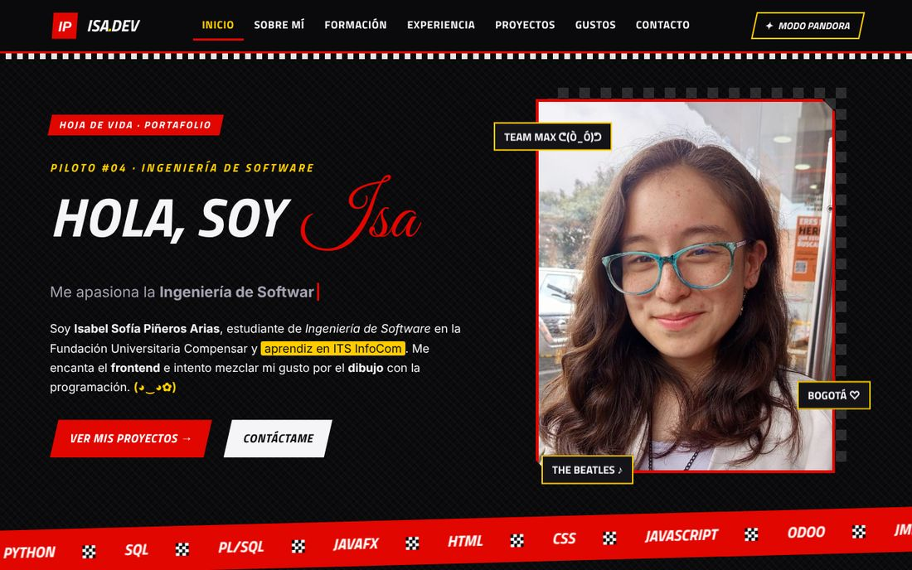
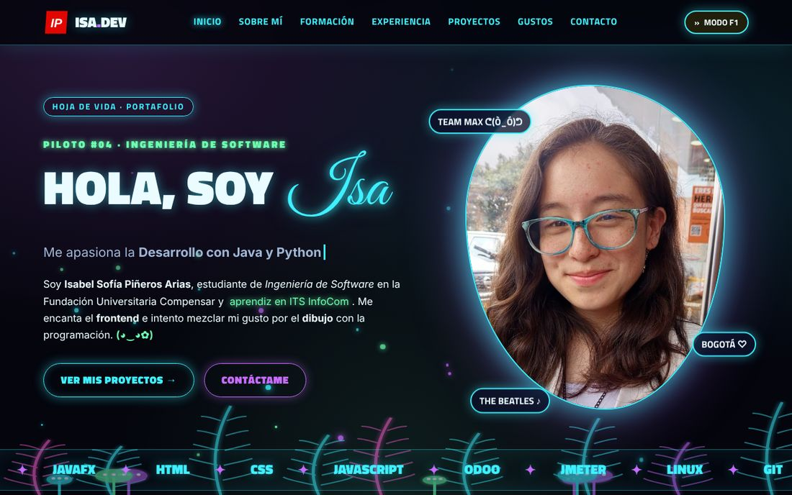
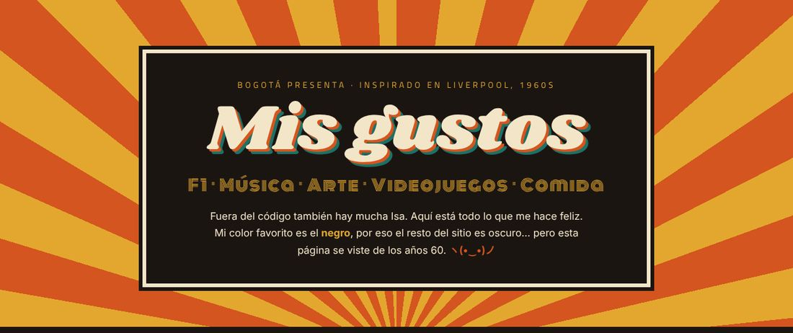
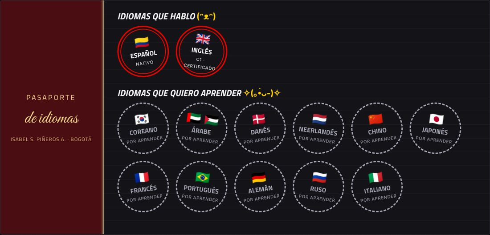
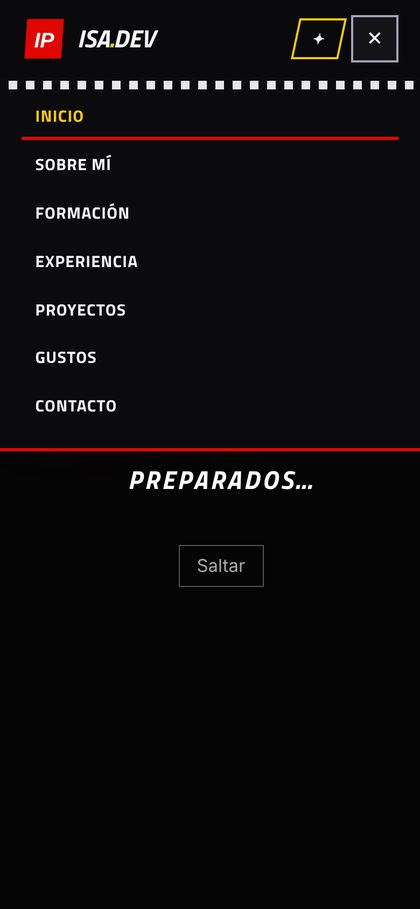

<div align="center">


# Hoja de vida web · Isabel Sofía Piñeros Arias

**Estudiante de Ingeniería de Software · Aprendiz en ITS InfoCom · Bogotá, Colombia**

*"Por más pereza o ganas de jugar que tenga, la programación siempre gana, porque me encanta."* (｀・ω・´)ゞ

[**Ver el sitio en vivo**](https://akaneamber.github.io/hoja-de-vida/) · [LinkedIn](https://www.linkedin.com/in/isabel-pi%C3%B1eros-852089251/) · [Correo](mailto:ispasofia02@gmail.com)


</div>

---

## Sobre el proyecto (◕‿◕✿)

Sitio web personal que funciona como mi hoja de vida pública. Lo hice para la actividad colaborativa del curso **Introducción a los lenguajes de Internet** en la **Fundación Universitaria Compensar**.

Quería que no fuera una hoja de vida más, sino que se notara quién soy. Por eso tiene **dos temas** y una página con su propio estilo:

| Tema | Inspiración | Detalles |
|------|-------------|----------|
| **Modo F1** | Fórmula 1 | Fibra de carbono, bandera a cuadros, semáforo de largada y telemetría |
| **Modo Pandora** | Universo de Avatar | Brillos bioluminiscentes, partículas flotantes y plantas que brillan |
| **Gustos** | Liverpool, años 60 | Rayos de sol, vinilo que gira, polaroids y boleto de concierto |

---

## Vista previa

<div align="center">

**Modo F1**



**Modo Pandora**



**Página de gustos**



<table>
  <tr>
    <td align="center"><br><sub>Pasaporte de idiomas</sub></td>
    <td align="center"><br><sub>Vista en celular</sub></td>
  </tr>
</table>

</div>

---

## Páginas

| Página | Qué tiene |
|--------|-----------|
| [Inicio](https://akaneamber.github.io/hoja-de-vida/index.html) | Semáforo de largada, mi foto, presentación y lema |
| [Sobre mí](https://akaneamber.github.io/hoja-de-vida/sobre-mi.html) | Perfil, datos personales y pasaporte de idiomas |
| [Formación](https://akaneamber.github.io/hoja-de-vida/formacion.html) | Educación y línea de tiempo de cursos |
| [Experiencia](https://akaneamber.github.io/hoja-de-vida/experiencia.html) | Experiencia, tabla de clasificación y panel de telemetría |
| [Proyectos](https://akaneamber.github.io/hoja-de-vida/proyectos.html) | Mis proyectos con filtro por tecnología |
| [Gustos](https://akaneamber.github.io/hoja-de-vida/gustos.html) | Música, F1, mis dibujos, videojuegos y comida |
| [Contacto](https://akaneamber.github.io/hoja-de-vida/contacto.html) | Formularios para escribirme |

---

## Lo que se usó φ(..)

- **HTML5 semántico:** `header`, `nav`, `main`, `section`, `article` y `footer`, con `div` y `span` para dar estructura y estilo.
- **Texto con énfasis:** `strong`, `em`, `mark`, `abbr`, `blockquote` y `code`.
- **Tablas completas:** `caption`, `thead`, `tbody`, `tfoot`, `scope` y `colspan`.
- **CSS3:** variables para los dos temas, Flexbox, Grid, degradados, animaciones y diseño adaptable para celular.
- **JavaScript:** cambio de tema guardado en el navegador, animaciones al hacer scroll, medidores, galería con visor y respuestas del servidor.
- **Fuentes libres** guardadas dentro del sitio: Titillium Web, Inter, Great Vibes, Shrikhand y Monoton.

### Peticiones al servidor

| Método | Para qué sirve | Dónde está |
|--------|----------------|------------|
| `GET` | Consultar información (los datos van en la URL) | Filtro de la página Proyectos |
| `POST` | Crear un registro nuevo | Formulario "Envíame un mensaje" |
| `PUT` | Actualizar un registro que ya existe | Formulario "Actualizar disponibilidad" |

> Las peticiones POST y PUT se envían a [JSONPlaceholder](https://jsonplaceholder.typicode.com/), una API pública de pruebas.

---

## Estructura

```
hoja-de-vida/
├── index.html
├── sobre-mi.html
├── formacion.html
├── experiencia.html
├── proyectos.html
├── gustos.html
├── contacto.html
├── css/
│   ├── estilos.css
│   └── fuentes.css
├── js/
│   └── main.js
├── fonts/
└── img/
```
---

<div align="center">

Hecho con mucho cariño por **Isabel Sofía Piñeros Arias** · [GitHub](https://github.com/AkaneAmber) (づ｡◕‿‿◕｡)づ

</div>
